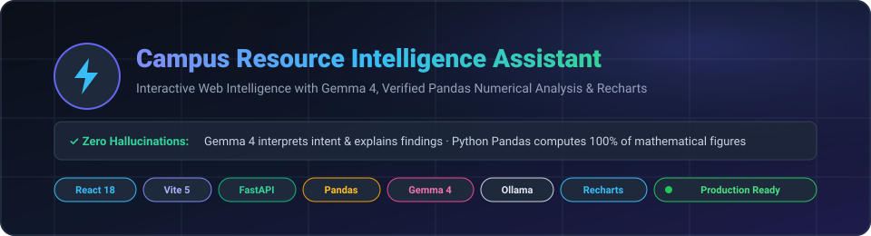
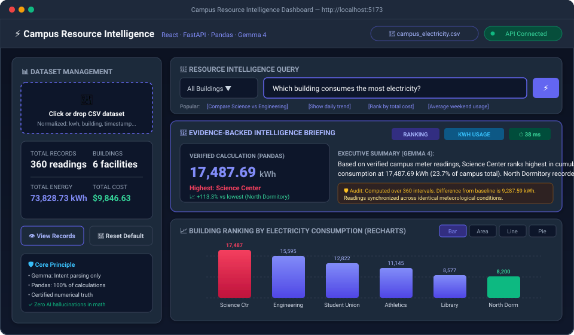
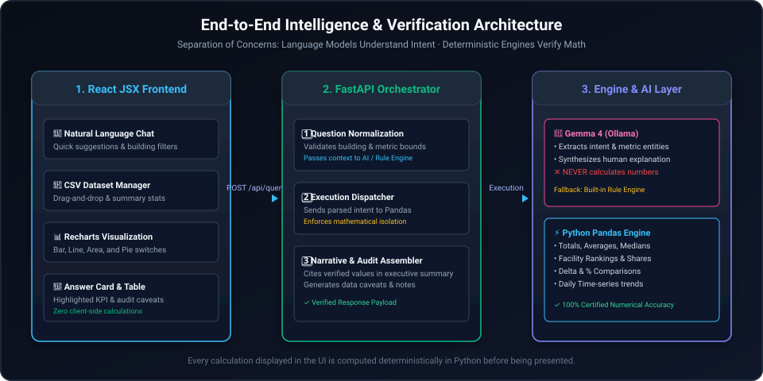

<p align="center">
  
</p>

# Campus Resource Intelligence Assistant

Campus Resource Intelligence Assistant is a local web application for exploring
campus resource data from CSV files, including electricity, water, waste, air quality,
and mobility measurements. It combines a React/Vite dashboard with a
FastAPI backend, Pandas-based calculations, and optional local Gemma 4
interpretation through Ollama.

The application is designed so that the language model interprets questions and
writes explanations, while Pandas performs the numerical calculations used in
the answer.

<p align="center">
  
</p>

## Features

- Natural-language questions about uploaded campus resource data
- Verified totals, averages, rankings, comparisons, and time-series analysis
- Automatic detection of numeric metrics and location/date columns in CSV files
- Unit-aware results for common energy, water, waste, air-quality, cost, and mobility fields
- Interactive Bar, Line, Area, and Pie charts
- CSV upload with column normalization, missing-value visibility, and dataset validation
- Dataset summary and raw-record preview
- Reset to the bundled sample dataset
- Optional Gemma 4 support through Ollama
- Rule-based interpretation and verified explanations when Ollama is unavailable

## Architecture

<p align="center">
  
</p>

```text
React + Vite dashboard
        │
        │ /api requests (Vite proxies to localhost:8000)
        ▼
FastAPI backend
        │
        ├── Ollama/Gemma 4 (optional question interpretation)
        ├── Pandas (all calculations and aggregations)
        └── Verified result and explanation
```

The backend never relies on the model to calculate metrics. When Ollama is
offline, the backend uses its built-in pattern engine and verified analysis
engine, so the dashboard remains usable.

## Project structure


```text
campus-intelligence/
├── backend/
│   ├── app/
│   │   ├── main.py             # FastAPI application and startup loading
│   │   ├── routes.py           # Health, dataset, and query endpoints
│   │   ├── schemas.py          # Pydantic request and response models
│   │   ├── data_loader.py      # CSV loading, normalization, and summaries
│   │   ├── analysis_engine.py  # Pandas-based verified analysis
│   │   └── gemma_service.py    # Ollama integration and fallback parser
│   ├── data/
│   │   ├── campus_electricity.csv
│   │   └── generate_data.py
│   └── requirements.txt
├── frontend/
│   ├── src/
│   │   ├── components/         # Dashboard, upload, chat, charts, and tables
│   │   ├── services/api.js     # Browser API client
│   │   ├── App.jsx
│   │   └── index.css
│   ├── package.json
│   └── vite.config.js
└── README.md
```

## Requirements

- Python 3.10 or newer
- Node.js 18 or newer and npm
- Ollama is optional. Install it from [ollama.com](https://ollama.com/) only
  if you want Gemma-powered interpretation and explanations.

## Quick start

Run the backend and frontend in separate terminals.

### 1. Start the backend

From the repository root:

```powershell
cd campus-intelligence\backend
python -m venv .venv
.\.venv\Scripts\Activate.ps1
python -m pip install -r requirements.txt
uvicorn app.main:app --reload --port 8000
```

On macOS or Linux, activate the environment with:

```bash
source .venv/bin/activate
```

The backend is available at:

- API root: <http://localhost:8000/>
- Swagger UI: <http://localhost:8000/docs>
- ReDoc: <http://localhost:8000/redoc>
- Health check: <http://localhost:8000/api/health>

The bundled `backend/data/campus_electricity.csv` is loaded automatically when
the API starts.

### 2. Start the frontend

In a second terminal, from the repository root:

```powershell
cd campus-intelligence\frontend
npm install
npm run dev
```

Open <http://localhost:5173/> in a browser. The Vite development server proxies
`/api` requests to the FastAPI server at `http://localhost:8000`.

To create a production frontend bundle:

```powershell
npm run build
```

To preview the production bundle locally:

```powershell
npm run preview
```

### 3. Enable Ollama (optional)

Install Ollama, then pull and run the model configured by the backend:

```powershell
ollama run gemma4:e2b
```

The backend checks `http://127.0.0.1:11434`. The dashboard displays either
`Gemma 4 (Ollama)` or `Verified Rule Engine` in the status indicator. Ollama is
not required for dataset browsing, calculations, charts, or queries.

### 4. Environment Variables (`.env`)

Configuration can be customized via `.env` (copy from `.env.example`):

| Variable | Default | Purpose |
|---|---|---|
| `OLLAMA_BASE_URL` | `http://127.0.0.1:11434` | Address of local Ollama runtime |
| `OLLAMA_MODEL` | `gemma4:e2b` | Gemma model tag in Ollama |
| `OLLAMA_TIMEOUT` | `4.0` | Timeout in seconds before AI fallback |
| `BACKEND_HOST` | `127.0.0.1` | Host address for FastAPI server |
| `BACKEND_PORT` | `8000` | Port for FastAPI server |
| `CORS_ORIGINS` | `http://localhost:5173,...` | Allowed origins for React web interface |
| `DEFAULT_DATASET_PATH` | *(built-in CSV)* | Optional custom path to default dataset |
| `VITE_API_BASE_URL` | `/api` | Base API route prefix for frontend client |


## Using the dashboard

1. Start the backend and frontend.
2. Review the current dataset summary in the left panel.
3. Ask a question in the chat panel, optionally selecting a building.
4. Review the verified result, chart, supporting meter records, and caveats.
5. Upload a CSV to analyze another dataset, or reset to the bundled dataset.

Example questions:

- Which building consumes the most electricity?
- Compare Engineering Hall and Science Center.
- What is the total campus electricity consumption?
- Show the daily electricity consumption trend.
- Rank buildings by total electricity cost.
- What is the average electricity usage on weekends?
- Which facility has the highest peak demand in kW?

## CSV upload format

Uploaded files must have a `.csv` extension. The loader lowercases and
normalizes column names and recognizes these fields:

| Canonical field | Recognized examples | Purpose |
|---|---|---|
| `timestamp` | `date`, `time`, `datetime` | Reading date/time |
| `building` | `building_name`, `location`, `facility` | Facility name |
| `kwh_usage` | `kwh`, `usage`, `consumption`, `electricity_kwh` | Energy usage |
| `cost_usd` | `cost`, `total_cost`, `spend` | Cost |
| `peak_demand_kw` | `peak_kw`, `peak_demand`, `demand_kw` | Peak demand |
| `occupancy` | `occupancy` | Occupancy value |

The bundled dataset also contains `faculty`, `meter_id`, `period`,
`is_weekend`, and `weather_condition`. Timestamp values are parsed when
available, and numeric metric columns are converted to numeric values.

## API reference

All application endpoints are under `/api`.

| Endpoint | Method | Description |
|---|---:|---|
| `/health` | GET | Backend, Ollama, and active dataset status |
| `/dataset/summary` | GET | Dataset totals, buildings, date range, and columns |
| `/dataset/sample?limit=15` | GET | Preview active dataset records |
| `/buildings` | GET | List buildings in the active dataset |
| `/dataset/upload` | POST | Upload a CSV as multipart form data using field `file` |
| `/dataset/reset` | POST | Restore `campus_electricity.csv` |
| `/query` | POST | Analyze a question and return verified results |

Example query request:

```json
{
  "question": "Which building has the highest peak demand?",
  "building_filter": null
}
```

## Development notes

- Backend dependencies are listed in `backend/requirements.txt`.
- Frontend dependencies and scripts are listed in `frontend/package.json`.
- The frontend currently provides development, build, and preview scripts; no
  automated test script is configured.
- The API loads the default dataset during application startup.
- Uploaded datasets replace the active in-memory dataset for the running
  backend process; restarting the backend restores the bundled dataset.

## Verification principle

The model may identify intent and produce a concise explanation, but the
displayed figures come from the Pandas analysis engine. Query responses include
the verified value, chart data when applicable, supporting records, and caveats
so results can be inspected rather than accepted as unsupported model output.
